# Guide d'utilisation de Prospector

Bienvenue cher membre de TNS dans Prospector !

Cette application vous permettra de gérer les projets de la junior, de prospecter de nouvelles entreprises et de garder un lien avec les clients.

Différents onglets s'offriront à vous en haut de la page tout au long de votre expérience.

## Page d'accueil

Lors de votre arrivée sur l'application, vous atterirez sur une page d'authentification : entrez votre email et votre mot de passe.

Note : pour le test de l'application, vous pouvez utiliser "admin" comme email et "pass" comme mot de passe admin.

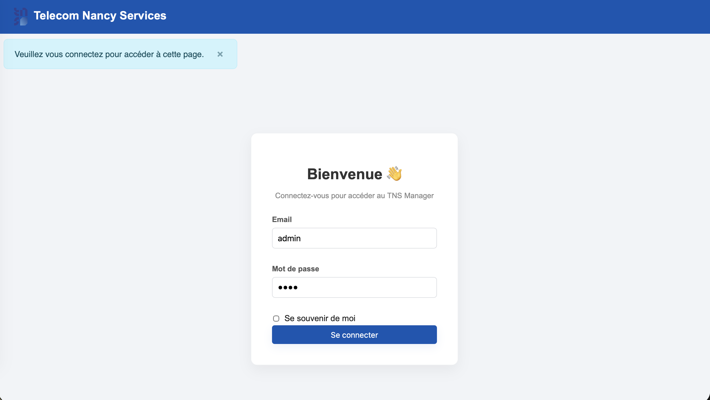

## Tableau de bord

C'est la page principale de l'application. Vous pourrez y voir d'un coup d'oeil les prochaines échéances sur vos différents projets, leur état actuel.

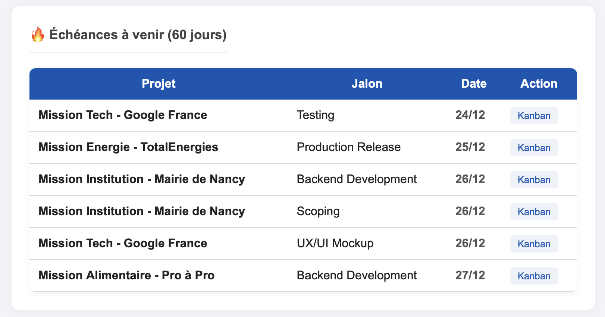

Vous pouvez également avoir un aperçu des interactions récentes avec vos clients.

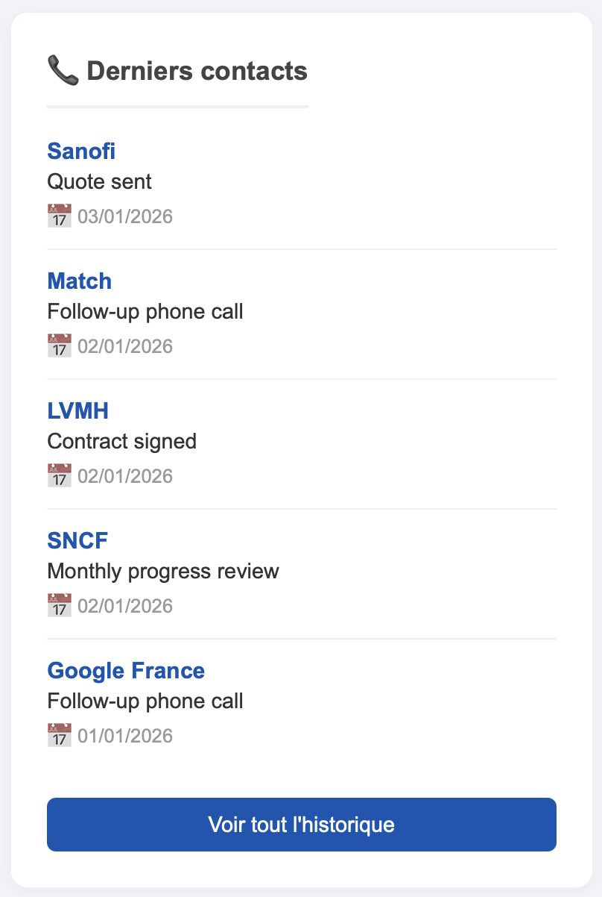

La page est aussi constituée de quelques chiffres sur les intervenants, les projets actifs et les clients.

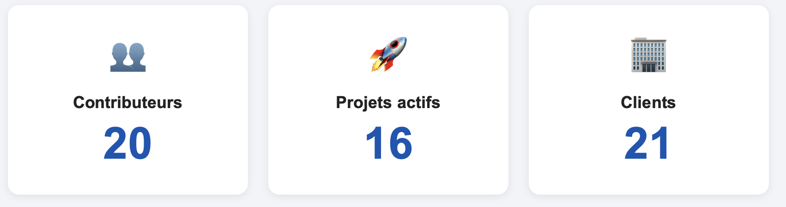

## Gestion des intervenants

Ici, vous avez la possibilité de manager vos intervenants.

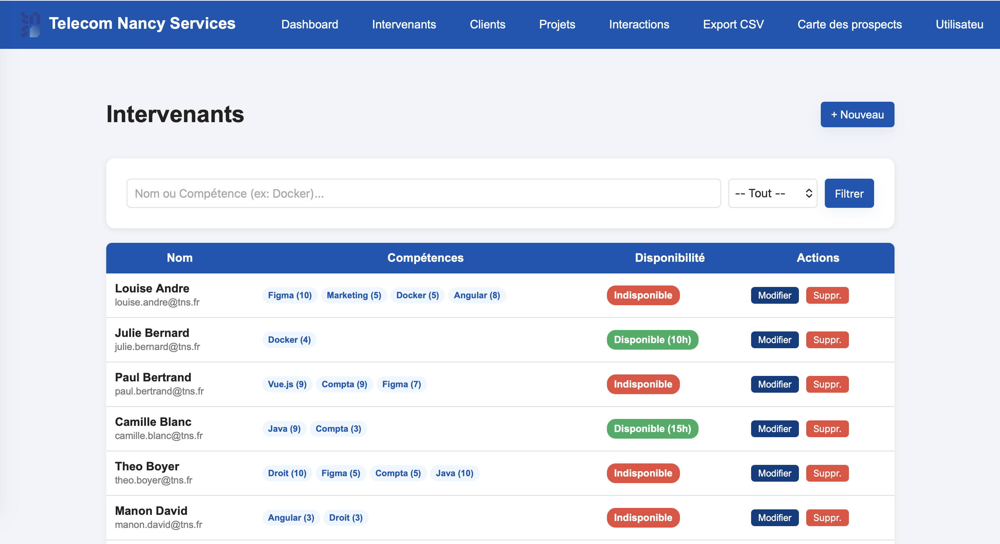

Vous pouvez gérer des informations telles que leur nom, prénom, compétences, leur degré de maitrise de ces compétences, s'ils sont disponibles ou non, et si oui, combien de temps par semaine.

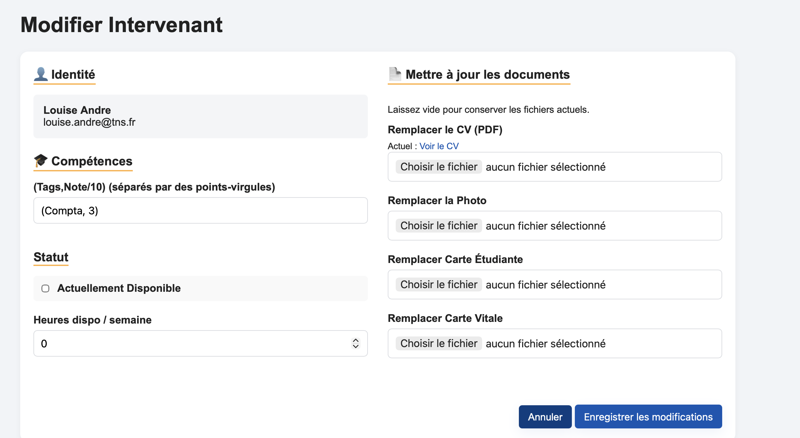

Vous pouvez leur ajouter des documents : CV, photo d'identité, carte étudiante, carte vitale.

## Gestion des clients

Sur cette page, vous pourrez voir la liste des clients de la junior-entreprise, accompagnés chacun de la date de dernier contact avec eux.

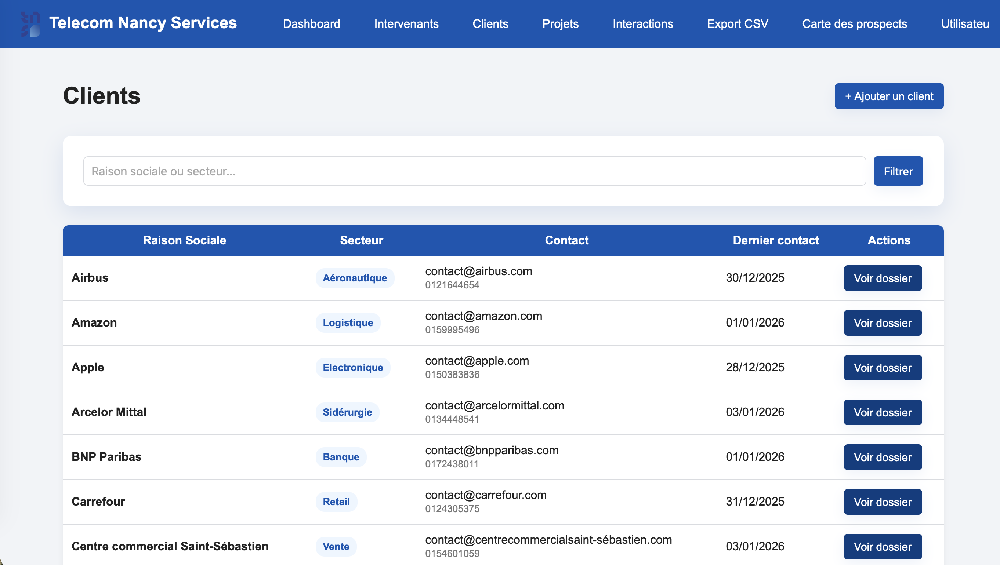

Chaque client possède des coordonnées ajustables : adresse mail et numéro de téléphone.

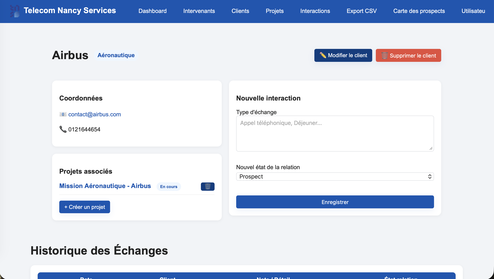

Vous avez également un aperçu des projets commandités par ce client.

Il est possible d'historiser une interaction avec ce même client sur sa page.
Toutes les interactions avec ce client sont visibles plus bas.

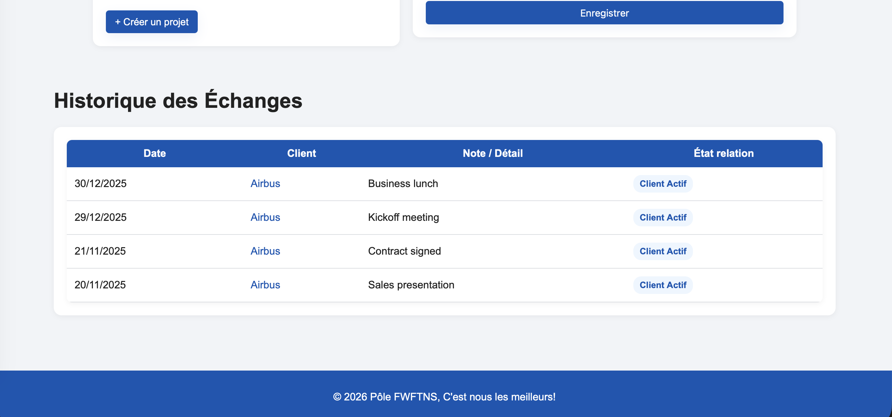

Enfin, modifier les informations relatives à un client est possible en cliquant sur le bouton "Modifier".

## Gestion des projets

Cette page permet d'accéder à tous vos projets. Vous pouvez voir des informations comme leur statut ou encore leur date de début.

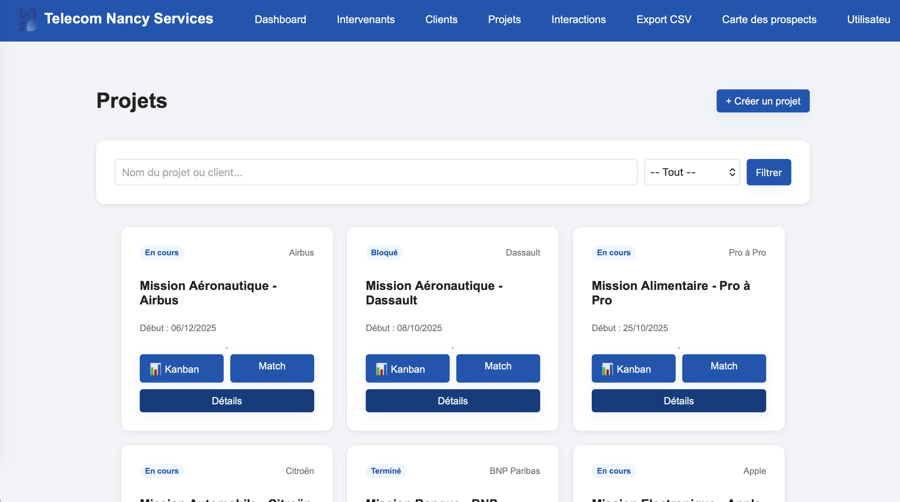

Plongons un peu plus en détail dans ces projets !

### Créer un projet

Créez un projet en cliquant en haut à droite sur "+ Créer un projet".

Un formulaire s'ouvrira pour y entrer les premières informations sur ce projet.

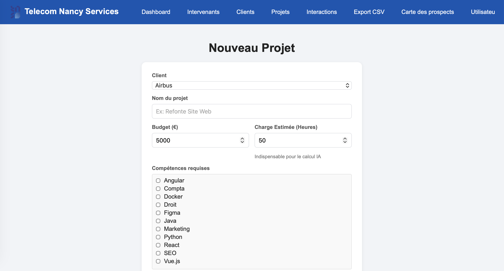

Remplissez bien tous les champs, et cliquez sur "Créer le projet".

### Détails sur projet

Après avoir créé le projet, vous atterirez sur la page de détails du projet.

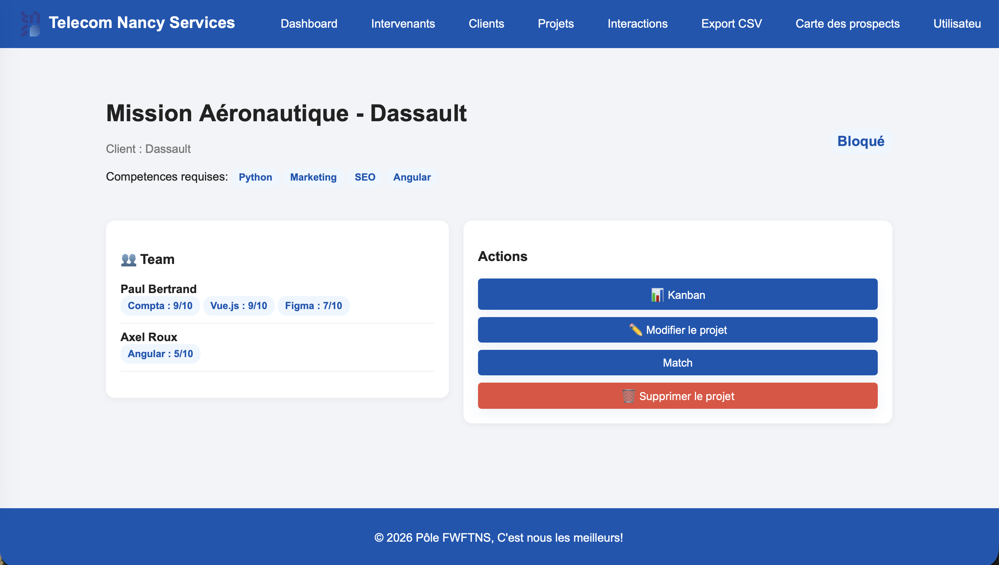

Vous pourrez y avoir qui a commandité ce projet, les compétences requises, les intervenants assignés ou encore le statut du projet.

Parmi les actions possibles, trois options s'offrent à vous : 

- Afficher le Kanban
- Modifer les détails du projet
- Effectuer un matching pour voir quels intervenants seraient le plus appropriés pour cette mission
- Supprimer le projet

### Kanban d'un projet

En cliquant sur "Kanban", vous atterirez sur un gestionnaire de jalons de projets, ce qui vous permettra d'avoir de la visibilité sur l'avancement du projet et des tâches restantes.

3 colonnes sont affichées :
- À venir : les jalons de cette catégorie n'ont pas encore commencé ;
- Actuel : ce jalon est en cours de travaux par l'équipe ;
- Terminé : ce jalon est complété.

Vous avez la possibilité de créer des jalons à l'aide de la barre au-dessus des colonnes de statuts susmentionnées.

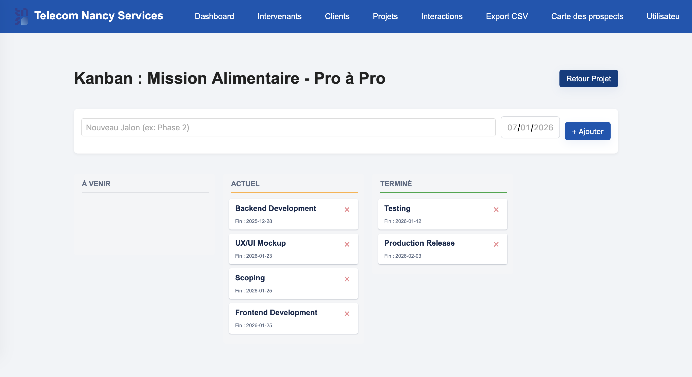

### Modifier les détails d'un projet

Cette page permet de modifier un projet. Vous pouvez, entre autres, y modifier les intervenants assignés à ce projet.

Cliquez sur le bouton bleu en bas à droite de la page pour sauvegarder vos changements.

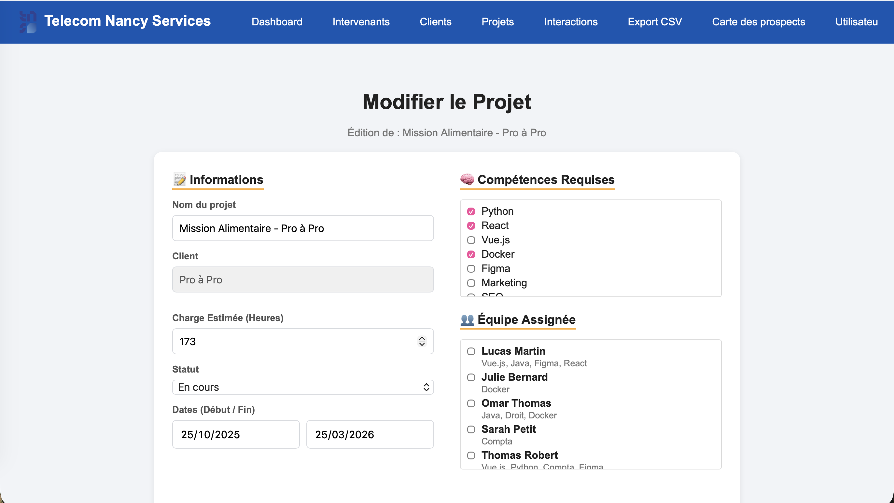

### Le matching

Il est parfois compliqué de savoir qui sont les personnes les plus aptes à mener à bien un projet.

Demander à chaque personne s'il se sent capable de faire tel ou tel projet ?
Trop long.

Laissez l'IA le faire à votre place.

En cliquant sur le bouton "Match", l'IA vous fera une suggestion personnalisée d'équipes potentielles pour une mission donnée, selon les compétences requises et les compétences maitrisées par vos intervenants.

À vous de choisir ou non une équipe.

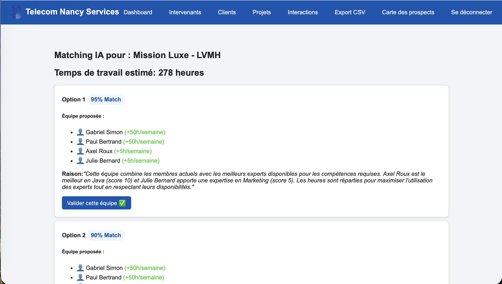

## Historique des échanges

Tous les échanges que vous avez eu avec un client seront répértoriés ici.

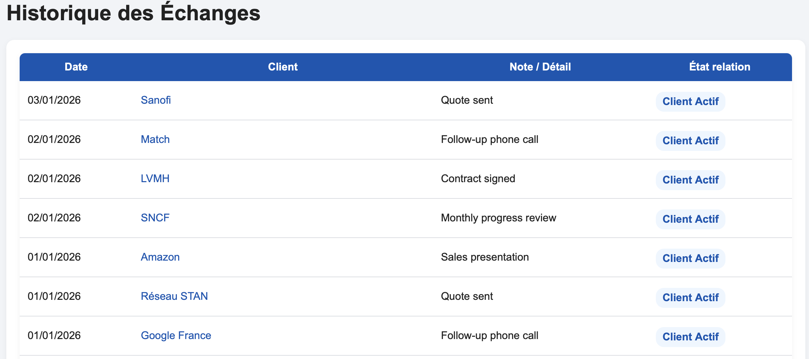

L'état de la relation avec ce client (au moment de l'interaction) est affiché, ainsi que le détail de l'interaction.

## Carte des prospects

Pourquoi chercher des entreprises manuellement quand on peut demander à un cercle rouge de le faire ?

C'est avec cette question qu'est née la carte des prospects. 

Elle vous permet, en décidant du rayon autour de Telecom Nancy, de trouver des prospects.

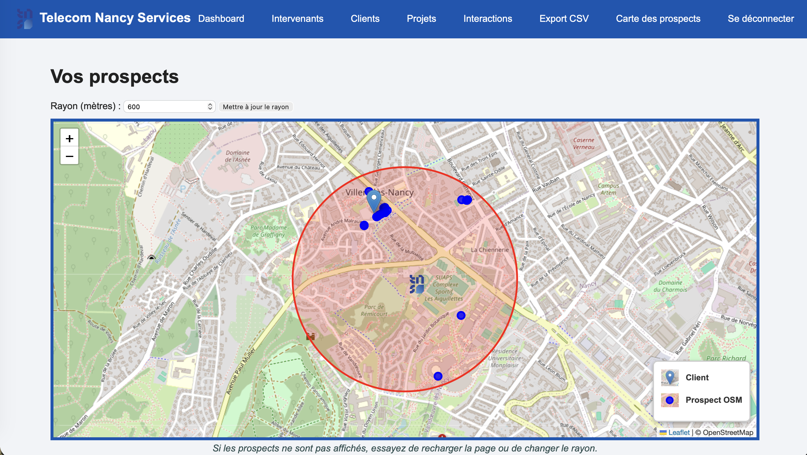

Vos prospects (ceux qui ne sont pas encore vos clients) sont représentés par des points bleus, tandis que vos clients effectifs sont représentés par un icône de position bleu clair (cf. la légende).

Mais comment puis-je ajouter un prospect à ma liste de client ?

C'est très simple : cliquez sur le point bleu puis sur "Ajouter à ma liste".

Et si je veux supprimer ce client de ma liste ?

C'est encore une fois très simple : cliquez sur l'icône bleu clair puis sur "Supprimer".

## Se déconnecter

Pour vous déconnecter, cliquez en haut à droite de la page sur "Se déconnecter".

